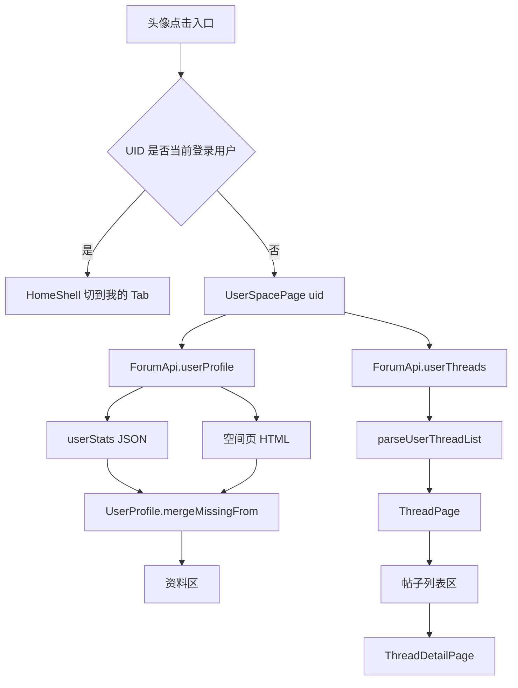
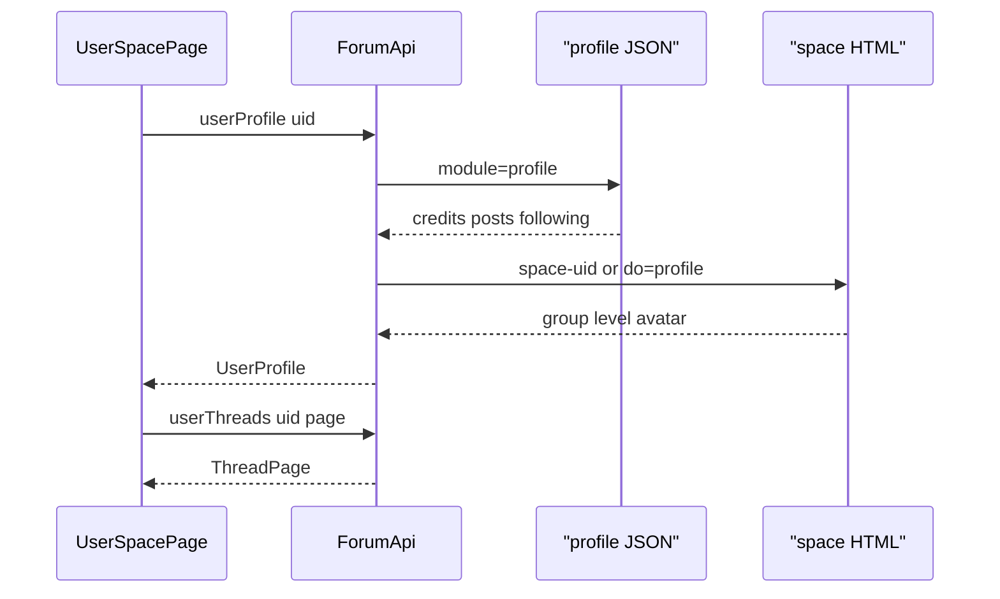

# 查看用户

Feature Name: view-user
Updated: 2026-10-22

## Description

在帖子列表与帖子详情中，点击他人头像进入独立的个人中心页，展示该 UID 的公开资料与主题列表；点击自己的头像则切到「我的」Tab。资料优先走已有移动端 JSON 接口 `api/mobile/index.php?version=4&module=profile&uid=N`，用户组 / 等级由空间页 HTML 补齐；主题列表解析 `home.php?mod=space&uid=N&do=thread`。本页与「我的」页分离：「我的」继续承载登录用户的设置与自动化。

## Architecture



数据流与现有「我的」页同源：`ForumApi.userStats` 已按任意 UID 调用移动端 profile 接口，且 `absorbCookies: false`。个人中心复用该接口，再请求空间页补用户组 / 等级，避免把设置页逻辑混进他人资料。



## Components and Interfaces

### 1. 入口：头像可点击

现有 `Avatar`（`lib/ui/widgets/common.dart`）无点击回调。帖子卡片整卡 `InkWell` 会吞掉头像点击。

改动：

- `Avatar` 增加可选 `VoidCallback? onTap`；有回调时外包 `GestureDetector`（`HitTestBehavior.opaque`）
- `ThreadTile` 增加 `VoidCallback? onAvatarTap`；作者行头像使用该回调，并在手势上抢先于整卡 `onTap`
- `ThreadDetailPage` 楼主行、回帖行头像在 `authorId != null && authorId > 0` 时按 UID 分流：等于当前登录用户则切到「我的」Tab，否则打开个人中心
- UID 缺失时 SnackBar 提示「无法打开该用户资料」

入口覆盖范围：帖子列表卡片作者行、帖子详情楼主行、帖子详情回帖行。搜索结果复用 `ThreadTile` 时一并生效。

### 2. 页面：`UserSpacePage`

新文件 `lib/ui/pages/user_space_page.dart`。入参：`required int uid`，可选 `String? username`（用于加载前标题占位）。

页面结构（自上而下，单 `CustomScrollView`）：

1. `AppBar`：标题为用户名，加载前用入参或「个人中心」
2. 资料卡：头像、用户名、UID、等级、用户组
3. 两排指标：人气 / 关注 / 粉丝；帖子数量 / 回帖数量 / 积分；星币单独一行或并入第二排右侧
4. 「主题」分区标题 + 帖子列表（复用 `ThreadTile`，`showBoard: true`）
5. 触底加载下一页；空态「该用户还没有发表主题」

视觉约束对齐 `DESIGN.md`：令牌走 `lib/design/tokens.dart`，卡片不透明，头像 `YuanSizes.avatarProfile`。资料卡可复用「我的」页渐变卡的布局结构，去掉自动功能入口。

本页为二级路由，`BottomBarInset.of(context)` 为 0，列表底部只留 `YuanSpace.xxl`。

### 3. 接口：`ForumApi`

现有 `userStats(int uid)` 保持不变，继续作为积分与统计主数据源。

新增：

```dart
Future<UserProfile> userProfile(int uid);
Future<ThreadPage> userThreads({required int uid, int page = 1});
```

`userProfile`：

1. 并行请求 `userStats(uid)` 与空间页 `home.php?mod=space&uid=$uid&do=profile`
2. JSON 优先，HTML 用 `mergeMissingFrom` 补头像、用户组、等级
3. JSON 与 HTML 都失败时抛 `ForumException`，由页面展示重试
4. HTML 含「您指定的用户空间不存在」或登录墙且目标用户空间不可见时，抛明确文案「该用户不存在或空间不可见」

`userThreads`：

1. 请求 `home.php?mod=space&uid=$uid&do=thread&view=me&from=space&order=dateline&page=$page`
2. 用新解析器 `parseUserThreadList` 抽出主题；若页面仍是 `li.kmlist` / `li[id^=normalthread_]`，内部复用 `parseThreadList`
3. 解析结果为空且页面含「还没有相关的帖子」「尚未发表」时返回空列表（`totalPages = 1`），由 UI 展示空态

请求均走已有 `DiscuzClient`，带当前 Cookie；游客可看的公开空间继续可看。

### 4. 解析层：纯 Dart

`parseProfileApi` 增补：

- `Variables.group.grouptitle` → `UserProfile.group`
- `Variables.group.stars` 或 `space.stars` → `UserProfile.level`（有独立等级文案时使用；否则 `level` 回落为 `group`）
- 目标用户头像：当前实现仅在 `member_uid == uid` 时取 `member_avatar`。查看他人时该条件不成立，头像必须由空间页 HTML 补齐，或按 Discuz 规则拼 `/data/avatar/` 路径作为第三来源

`parseProfile` HTML 兜底增补等级选择器（`等级[:：\s]*`），与现有用户组正则并存。

`parseUserThreadList(String html, {int page = 1})`：

- 优先调用 `parseThreadList`
- 若条目为 0，再扫空间页常见结构：`div.xl` / `li` 内 `a[href*="thread-"]`，作者固定为空间主人
- 分页继续用现有 `_parseTotalPages` 逻辑（`共 N 页` / `page=`）

解析层不 import Flutter，离线样本可回归。

### 5. 导航

`in_app_nav.dart` 增加 `InAppTargetKind.user`，解析 `space-uid-N` / `uid=N` 的空间链接，站内资料链接可直接打开个人中心。`main.dart` 注册 `user: (uid) => UserSpacePage(uid: uid)`。

从个人中心点击主题，沿用现有 `ThreadDetailPage(tid: ...)` push。

点自己头像：`HomeShell` 增加 `InheritedWidget`（如 `HomeShellScope.selectTab(2)`）。嵌套路由内调用后 `Navigator.popUntil` 回到根再切 Tab，避免个人中心压在「我的」之上。未登录或 `AppState.user.uid` 为空时，按他人资料打开个人中心。

## Data Models

`UserProfile` 增补：

```dart
/// 等级文案；站点无独立等级时与用户组相同。
final String? level;

/// 回帖数 = max(0, posts - threads)，由 getter 计算，不单独持久化。
int? get replies {
  if (posts == null || threads == null) return null;
  final v = posts! - threads!;
  return v < 0 ? 0 : v;
}
```

`copyWith` / `mergeMissingFrom` 同步带上 `level`。

人气对应已有字段 `views`。帖子数量对应 `threads`。回帖数量用 `replies` getter。需求字段与模型映射：

| 需求字段 | 模型字段 | 主数据源 |
| --- | --- | --- |
| 用户 ID | `uid` | JSON `space.uid` |
| 等级 | `level` | HTML / `group.stars`，空则用 `group` |
| 用户组 | `group` | HTML / `Variables.group.grouptitle` |
| 人气 | `views` | JSON `space.views` |
| 关注 | `following` | JSON `space.following` |
| 粉丝 | `followers` | JSON `space.follower` |
| 帖子数量 | `threads` | JSON `space.threads` |
| 回帖数量 | `replies` | `posts - threads` |
| 积分 | `points` | JSON `space.credits` |
| 星币 | `coins` | JSON extcredits 按名称映射 |

`ThreadItem` 无需改字段。列表项展示标题、`timeText`、`replies`、`views`。

## Correctness Properties

- 个人中心只读目标 UID 的公开数据，不写入 `AppState.user`
- 点击自己的头像切换到「我的」Tab，不打开 `UserSpacePage`
- `userStats` 请求继续 `absorbCookies: false`，避免 mobile 接口重发 `saltkey` 污染会话
- 头像点击与整卡打开帖子互斥：点头像只进个人中心，点卡片其余区域只进帖子
- 回帖数计算为 `max(0, posts - threads)`，缺任一操作数时展示「—」
- 解析失败返回空或抛业务异常，页面可重试，不导致白屏
- 颜色 / 间距 / 字号只使用 `tokens.dart`

## Error Handling

| 场景 | 处理 |
| --- | --- |
| UID 缺失或 <= 0 | 不跳转，SnackBar「无法打开该用户资料」 |
| 资料 JSON 与 HTML 均失败 | 全页错误 + 重试，重试再次调用 `userProfile` |
| 用户不存在 / 空间关闭 | 全页文案「该用户不存在或空间不可见」 |
| 资料成功、主题列表失败 | 资料区保留，列表区错误 + 重试 |
| 主题列表为空 | 空态「该用户还没有发表主题」 |
| 分页请求失败 | 保留已加载页，底部提示失败，允许再次触底重试 |
| 头像 URL 失败 | 现有 `Avatar` 字母占位 |

错误文案走 `ForumException` / 现有中文提示风格，不把原始 HTML 堆到界面。

## Test Strategy

离线单测（纯 Dart，MockClient）：

1. `parseProfileApi`：补用户组 / 等级；查看他人时不误用当前登录用户头像
2. `parseUserThreadList`：comiis `kmlist` 样本能出 `ThreadItem`；空空间页返回空列表
3. `ForumApi.userProfile`：JSON 成功 + HTML 补 group；JSON 500 时退回 HTML；两边失败抛错
4. `ForumApi.userThreads`：第一页与 `page=2` 的 URL 与分页
5. `UserProfile.replies`：`posts=714, threads=39` → 675；缺字段 → null；负差 → 0

Widget / 手势：

- `ThreadTile`：点头像触发 `onAvatarTap`，不触发整卡 `onTap`
- `UserSpacePage` golden：资料卡字段齐全（可复用 uid=31981 样本数字）

回归命令：

```bash
flutter analyze
flutter test test/user_stats_test.dart
flutter test test/user_space_test.dart
```

实现阶段用真实抓包补 `tool/user_space_check.dart`（`--live` 拉 uid=31981）。

## References

- `ycoo_client/README.md`：移动端 profile 接口与空间页字段
- `ycoo_client/lib/data/forum_api.dart`：`me()` / `userStats()`
- `ycoo_client/lib/data/parsers.dart`：`parseProfileApi` / `parseProfile` / `parseThreadList`
- `ycoo_client/lib/models/models.dart`：`UserProfile`
- `ycoo_client/lib/ui/pages/profile_page.dart`：登录用户「我的」页
- `ycoo_client/DESIGN.md`：视觉硬约束
- `ycoo_client/test/user_stats_test.dart`：uid=31981 真实样本
