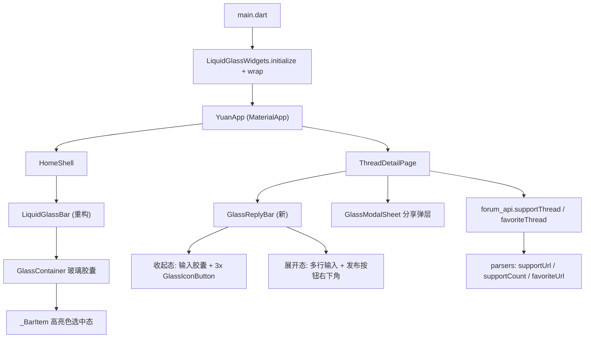

# 技术设计：液态玻璃底栏与回帖栏改版

Feature Name: glass-nav-reply-bar
Updated: 2026-10-23

## 1. 描述

基于 liquid_glass_widgets 1.14.1（Flutter ≥3.41）重构底栏与详情页回复栏：底栏选中态去掉背景块、纯高亮色区分；详情页底部改为悬浮液态玻璃回复栏（输入框 + 点赞/收藏/分享，点击展开多行输入与输入法，发布按钮右下角）；App 启动预热 Shader 并注入玻璃主题。工具链升级 Flutter 3.41.9 / Dart 3.11.5。

## 2. 架构



分层原则不变：解析层纯 Dart；玻璃组件集中在 `lib/design/glass/` 与 `lib/ui/widgets/`；颜色/尺寸一律走 tokens。

## 3. 组件与接口

### 3.1 main.dart — 玻璃引擎初始化

```dart
await LiquidGlassWidgets.initialize();          // 预热 Shader，防首帧白闪
runApp(LiquidGlassWidgets.wrap(                 // 注入玻璃主题 + 自适应质量
  adaptiveQuality: true,                        // 首帧 standard；设备光栅预算达标才升 premium
  respectSystemAccessibility: true,             // 减弱透明/动效自动降级
  brightnessResolver: Theme.maybeBrightnessOf,  // 桥接 Material 深浅色
  theme: GlassThemeData.simple(blur: 6, thickness: 24),
  child: const YcooApp(),
));
```

### 3.2 LiquidGlassBar（lib/design/glass/liquid_glass_bar.dart，重构）

- 容器：`ClipRRect + BackdropFilter + Container` 替换为 `GlassContainer`：
  - `shape: LiquidRoundedSuperellipse(borderRadius: YuanRadius.lg)`
  - `settings: LiquidGlassSettings(glassColor: semantic.glassFill, blur: YuanGlass.barBlur, thickness: YuanGlass.barThickness)`（新增 `YuanGlass` token 组）
  - `height: YuanSizes.barHeight`、外层 `SafeArea + Padding` 与现有完全一致（`BottomBarInset` 尺寸契约不变）
- 选中态（`_BarItem`）：删除 `Positioned` 椭圆背景块；选中 = `brandPrimary` 高亮（图标 + 文字 + w600），未选中 = `textSecondary`；保留 `AnimatedSlide` 上浮与 `AnimatedDefaultTextStyle/AnimatedContainer` 颜色过渡（`disableAnim` 时零时长）；角标逻辑不动。
- 顶部高光细线与手动描边删除（GlassContainer 自带 rim light，避免双重描边）。

### 3.3 GlassReplyBar（lib/ui/widgets/glass_reply_bar.dart，新增，纯展示）

```dart
class GlassReplyBar extends StatefulWidget {
  const GlassReplyBar({
    required this.controller,        // TextEditingController
    required this.onSend,            // Future<bool> Function(String)
    required this.onLike, required this.onFavorite, required this.onShare,
    required this.liked, required this.favorited,
    required this.likeBusy, required this.favBusy, required this.sending,
    required this.expanded, required this.onExpandChanged,
  });
}
```

- **收起态**（高度 ≈ 64 + 内边距）：`GlassContainer`（胶囊形状）内 `Row`：
  - `Expanded` 输入胶囊：Material `TextField`（tokens 样式，`surfaceContainer` 填充、无描边），tap → `onExpandChanged(true)`
  - `GlassIconButton(icon: thumb_up_outlined, size: 40)` 点赞（`liked` 时 `thumb_up` + brandPrimary）
  - `GlassIconButton(icon: star_border/favorite_border)` 收藏（同上高亮规则）
  - `GlassIconButton(icon: ios_share)` 分享
- **展开态**：同一 `GlassContainer`（`AnimatedSize` 过渡）内 `Column`：
  - 多行 `TextField`（minLines 3 / maxLines 6，自动聚焦）
  - 底行：`Spacer` + `FilledButton.icon(send, 发布)`（右下角；`sending` 时进度圈）
  - 3 个动作按钮隐藏（展开态专注输入）
- 收起触发：展开态 `TextField` 失焦（`FocusNode` listener + 内容为空时）或外部 tap。
- 玻璃层数：常驻 1 层（GlassReplyBar 的 GlassContainer）；分享弹层按需 +1。GlassIconButton `useOwnLayer: false`，随容器合成。

### 3.4 ThreadDetailPage 接线（lib/ui/pages/thread_detail_page.dart）

- 状态：`_liked / _favorited`（会话内本地标记）、`_likeBusy / _favBusy`、`_replyExpanded`。
- `_like()`：`d.supportUrl == null` → toast「该帖不支持点赞」；否则 `forum_api.supportThread(...)` → 成功：`_liked=true` + toast 站点文案/「已支持」；失败：toast 站点错误文案（未登录提示登录）。
- `_favorite()`：同上，`favoriteUrl` + `forum_api.favoriteThread(...)`；站点返回「已收藏」也置 `_favorited=true`。
- `_showShareSheet()`：`GlassModalSheet.show` → 两个 ListTile：「复制链接」（`Clipboard`）、「在浏览器打开」（`launchUrl externalApplication`）。
- `_sendReply()` 成功后：清空 controller、`onExpandChanged(false)`、`_load(1)`（沿用现有逻辑）。
- `_replyBar` 实现替换为 `GlassReplyBar`；仍在 `body` Column 底部（键盘随行上移契约不变）。

### 3.5 解析层（lib/data/parsers.dart + lib/models/models.dart，纯 Dart）

`ThreadDetail` 新增字段（默认 null，向后兼容）：

| 字段 | 来源 | 说明 |
|------|------|------|
| `supportUrl` | `a[href*="action=recommend&do=add"]` 的 href（绝对化） | 点赞接口地址（含 hash） |
| `supportCount` | `id="recommendv_add"` 元素文本 parseInt | 支持人数（可空） |
| `favoriteUrl` | `a[href*="ac=favorite&type=thread"]` 的 href（绝对化） | 收藏接口地址（含 formhash） |

### 3.6 forum_api（lib/data/forum_api.dart）

```dart
Future<SiteActionResult> supportThread(String url);   // GET → inajax 消息解析
Future<SiteActionResult> favoriteThread(String url);  // GET → inajax 消息解析
```

- `SiteActionResult{ok, message}`：复用回复流程的 inajax `CDATA` 提示提取逻辑（`<root><![CDATA[...]]></root>`）；HTTP 非 200 / 无 body → ok=false + 统一中文错误。
- `absorbCookies: false` 语义与移动端接口一致（避免 saltkey 污染），沿用现有 GET 封装。

## 4. 数据模型

仅 `ThreadDetail` 扩展 3 个可空字段（见 3.5）；`AppSettings` 无新增（点赞/收藏状态为会话内状态，不持久化——站点无「我的点赞」查询接口，持久化会引入状态漂移）。

## 5. 正确性属性

1. **P1**：选中态永远无背景块；选中/未选中仅靠颜色与图标填充区分。
2. **P2**：底栏高度与 `BottomBarInset` 契约不变（`YuanSizes.barTotalHeight = 4 + 64 + 12`）。
3. **P3**：解析层新增代码不 import Flutter；`dart run tool/parse_test.dart ../recon` 全过。
4. **P4**：Skia/Web/测试环境走降级路径（FakeGlass/轻量磨砂），布局与交互与 Impeller 路径一致。
5. **P5**：点赞/收藏/分享失败不改变本地状态；成功才置高亮。
6. **P6**：回复失败保留输入与展开态；成功清空 + 收起 + 刷新。

## 6. 错误处理

| 场景 | 处理 |
|------|------|
| Shader 加载失败 | 包内建 FakeGlass 回退；App 不感知 |
| 点赞接口返回未登录/风控文案 | toast 透传站点文案；本地状态不变 |
| 收藏接口返回「已收藏」 | 置已收藏态 + toast 已收藏 |
| supportUrl/favoriteUrl 解析为空 | 按钮点击 toast「该帖不支持该操作」 |
| 回复发送异常 | 保留输入 + 展开态 + 站点错误文案 |
| 分享弹层无链接（异常态） | 仅显示复制链接项禁用态；按钮兜底 toast |

## 7. 测试策略

| 层 | 测试 | 方式 |
|----|------|------|
| 解析 | `test/support_favorite_test.dart`：内嵌真实 HTML 片段 → supportUrl/supportCount/favoriteUrl 断言 | 纯 Dart，入 CI offline 列表 |
| 接口 | MockClient 走通 supportThread/favoriteThread 成功 + 站点错误文案两条路径 | 纯 Dart |
| 组件 | `test/glass_reply_bar_test.dart`：收起态三按钮回调、点击输入展开、发布按钮回调、失败保留文案 | widget test（测试环境走玻璃降级路径，验证 P4） |
| 底栏 | 既有 `bottom_bar_inset_test` / golden 回归；选中态无背景块以代码审查 + golden 重建确认 | `--update-goldens` |
| 全量 | `flutter analyze` 0 issue + `flutter test` 全过 | 本地（3.41.9） |

## 8. 工具链与依赖变更

| 项 | 旧 | 新 |
|----|----|----|
| Flutter | 3.24.5 | 3.41.9（本地 /opt/sdk/flutter_3.41.9 + CI workflow） |
| Dart | 3.5.4 | 3.11.5（pubspec `sdk: ^3.11.0`） |
| liquid_glass_widgets | 无 | `^1.14.1` |
| dynamic_color | 1.7.0（锁旧 Gradle） | 1.7.0 保持（AGP 8.1/Gradle 8.3 不动，AGP 9 未被 3.41 支持） |
| CI JDK | 17 | 17 保持 |

风险与对策：
1. **Android Gradle 链**：Flutter 3.41 最低 Gradle/AGP 要求若高于 8.3/8.1，CI 构建报错时再升 wrapper（8.9）与 AGP（8.6），不影响 Dart 侧。
2. **玻璃在测试环境**：FakeGlass 路径若不渲染子树（需验证），widget 测试用 `find.byType(GlassContainer)` 定位替代内部查找。
3. **pubspec.lock**：新增依赖后用 `PUB_HOSTED_URL=https://pub.flutter-io.cn flutter pub get` 保持镜像地址。

## 9. 文档同步

- AGENTS.md：技术边界表（Flutter/Dart/玻璃库）、模块地图（glass_reply_bar、YuanGlass）、常用命令不变。
- DESIGN.md：新增「液态玻璃」节（GlassThemeData 参数、选中态规则、回复栏规格、层数约束）。
- TODO.md：新增 P10 条目与完成边界。
- README.md：构建章节 Flutter 版本、功能清单（点赞/收藏/分享）、实测记录。

## 10. 参考

- [^1]: (Website) - [liquid_glass_widgets | pub.dev](https://pub.dev/packages/liquid_glass_widgets)
- [^2]: (Website) - [What's new in Flutter 3.41](https://flutter.dev/blog/whats-new-in-flutter-3-41)
- [^3]: (Filename#L110) - GlassContainer 构造（本设计按 1.14.1 源码核对）
- [^4]: (Filename#L99) - GlassTextField.bottom 面板（展开态参考）
